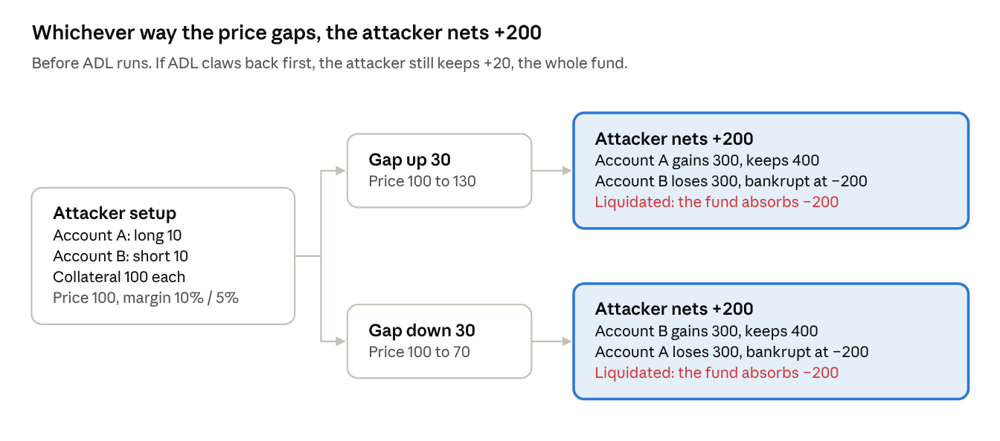

# Case study: a risk-free perp attack

A model checker can find incentive exploits, not just bugs. On a small model of a perpetual-futures liquidation mechanism, Quint found a risk-free attack on its own, and showed which margin settings close it.

## The problem: exploits where no step is a bug

The costliest failures in on-chain finance are often not code bugs. Every function does what its specification says, and a participant with an incentive finds a legal *sequence* of actions that pays them at others' expense.

| Exploit | What the mechanism allowed |
|---|---|
| Vault self-liquidation (Hyperliquid JELLY, 2025) | A vault inherited a position its owner then moved against it |
| Keeper inaction (MakerDAO, 2020) | Liquidating stopped paying, so collateral sold near zero |
| ADL overshoot ([Hyperliquid, 2025](https://arxiv.org/abs/2512.01112)) | $2.1B closed in 12 minutes; winners lost $45M to $52M extra |
| [Address poisoning](https://www.usenix.org/conference/usenixsecurity25/presentation/tsuchiya) (2025) | 270M lookalike transfers, 17M victims, $83.8M+ lost |

They share a shape: **there exists** an attacker strategy that gains **for all** reasonable market responses. Software agents make this class more urgent, because they search action spaces faster and more patiently than people do.

## The idea: split the quantifiers

Quint has no notion of payoff or equilibrium. But a bounded "exists, for all" question fits its two layers, and then a violated invariant *is* a concrete attack:

- **"Exists" comes from the model checker.** Searching every action sequence is searching every attacker strategy.
- **"For all" comes from pure functions.** A `forall` over a finite set of market responses is ordinary Quint.

```quint
// The attacker's gain if the oracle moves by d and keepers then act.
pure def gainAfter(st: State, d: int): int =
  attackerEquity(liquidateAll(applyMoveOracle(st, d))) - attackerEquity(st)

// Both directions must be possible, and every big move must pay the attacker.
pure def riskFree(st: State): bool = and {
  eventMoves(st).exists(d => d > 0),
  eventMoves(st).exists(d => d < 0),
  eventMoves(st).forall(d => gainAfter(st, d) > 0),     // "for all"
}

// No reachable state, with every attacker account still healthy, is a risk-free setup.
val noRiskFreeAttackFromHealth: bool =
  attackersHealthy implies not(riskFree(s))             // "exists", via the checker
```

Published TLA+ and Quint work usually models adversaries as safety violations, not payoffs. Incentives are handled today by sampled agent-based simulation, hand-written proofs, or equilibrium checkers such as PRISM-games. Splitting the quantifiers this way gets a bounded version of the incentive question out of an ordinary safety checker.

## The model

One perp market, isolated margin, three traders (two controlled by the attacker), an insurance fund backed by auto-deleveraging (ADL), and an oracle that can gap anywhere from 50 to 150. PnL settles continuously, so each account's collateral is its equity. Liquidation hands the position and whatever equity is left (positive or negative) to the insurance fund. While the fund is in deficit, ADL closes its position against a profitable trader on the other side and charges them for the deficit.

The [base model](quint-practice.md) has conservation invariants (collateral is neither created nor destroyed, and open interest nets to zero), witnesses for every action, and a second step relation for the "prompt keepers" assumption. The game module imports it and adds the attacker's view.

## The result

<figure class="fig">

<figcaption>Whichever way the price gaps, the attacker nets +200 before ADL runs. If ADL claws back first, the attacker still keeps +20: the entire insurance fund.</figcaption>
</figure>

Liquidation caps each account's loss at its collateral, so the bankrupt side's extra 200 falls on the fund, which drops from 20 to −180. ADL then targets the profitable opposite position, which is the attacker's own winning account. Even if ADL runs first and claws back 180, the attacker keeps +20, the whole fund. Apalache found this exhaustively in about two minutes.

| Margins (initial / maintenance) | Result | Checked by |
|---|---|---|
| 10% / 5% | **Attack found in one step** | Apalache (exhaustive) |
| 60% / 5% | **Attack found**, after drift wears an account down | Simulator |
| 60% / 60% | None found | Simulator, 20,000 runs |

## What it shows

- **The checker found bad-debt farming unaided**, given only a definition of "risk-free". Nobody told it about straddles.
- **Raising initial margin alone does not close it.** Maintenance margin must cover the largest possible gap, which is a design rule you can now state and check.
- **Stating intent was the hard part.** "Gains on *every* move" found nothing, because a straddle loses a little on small moves. "Gains on every *large* move" found the attack. Defining the property is the essential complexity; the checker does the rest.
- **Bounds create artifacts.** At a hard price bound, a one-way bet is trivially risk-free. The `riskFree` definition requires both directions to be possible to rule that out.

> [!TIP]
> **Write the attack as the negation of an invariant.** "No reachable state is a risk-free setup" turns an economic question into a safety property any model checker can search.

## Limits

One market, three traders, one-move lookahead, no probabilities and no mixed strategies. This is a bounded search for a specific class of exploit, not a proof of incentive compatibility. Within those bounds it is exhaustive, which is more than simulation gives you.

The same model doubles as a test oracle for an implementation of the engine: see [the next case study](model-based-testing.md).
